# Microsoft Graph Inactive Account Report with Python

**One app registration. Eight identities in three seconds. One outsider hiding as an employee.**

This is Week 9 of my 12 week IAM Engineer portfolio. I wrote a Python script that signs in to Microsoft Graph as its own app, pulls every user in my Entra ID tenant along with when they last signed in, flags anyone who has gone quiet or never signed in at all, looks up each person's manager, and writes a remediation report that tells a reviewer exactly what to do with each account.

Week 8 ended with a known limitation: my break glass alert signed in to Graph as me, so it could not run on its own. This week the script has its own identity, an app registration with two read only permissions, which is the piece unattended automation needs.

The report ran clean on the first real try and was still wrong about one account. Reading the output line by line instead of trusting it turned up an external user that the script was treating like an employee. Finding and fixing that was the best part of the week.

Every claim in this write up is backed by a screenshot or an evidence file in this repo.

---

## The 30 second version

| Question | Answer |
| --- | --- |
| **What problem does this solve?** | Accounts nobody uses are open doors. Auditors ask for a list of them, and building that list by hand means clicking through every user in the portal, checking two different sign in dates, and looking up each manager. It is slow, and it is easy to miss someone. |
| **What did I build?** | `inactive_user_report.py`, a Python script that authenticates with the OAuth 2.0 client credentials flow through MSAL, pulls all users with `signInActivity` from Microsoft Graph with pagination and throttling handled, classifies each account (active, inactive, never signed in, or too new to judge), looks up managers, and writes a CSV with a finding and a recommended action per account. Secrets live in a git ignored `.env` file. |
| **How did I prove it works?** | Tested the query by hand in Graph Explorer first, ran the script at the real 90 day policy, predicted which accounts a 3 day threshold would catch from the raw Graph data and then confirmed it, found and fixed a detection gap, reran to prove nothing else changed, and cross checked a result against the Entra portal. |
| **Tools** | Python 3.12, MSAL, requests, python dotenv, Microsoft Graph REST API v1.0, Graph Explorer, Microsoft Entra admin center (app registrations), Microsoft Entra ID P2 (trial), VS Code, Windows PowerShell |
| **Built on** | October 2, 2026 |

---

## Explain it like I am in 5th grade

Picture a drive through window. Behind it is a kitchen that knows everything about every person in my company: their name, their boss, and the last time they walked through the front door. That kitchen is **Microsoft Graph**.

My script is a car that pulls up to the window and places an order: "Give me everyone, and when each of them last showed up." But the window does not serve just anybody. First the car needs a badge. To get one, I registered the car with the company (**app registration**), gave it its own password (**client secret**), wrote down exactly which menu items it is allowed to order (**permissions**), and had the principal sign the permission slip (**admin consent**).

The kitchen hands the food out in bags of 120, with a note on each bag that says where to pick up the next one. The script keeps following the notes until there are none left. Then it sorts everyone into piles, asks who each person's boss is, and writes it all into a spreadsheet.

| Piece | Drive through version | Real version |
| --- | --- | --- |
| **REST API** | The window and its menu | A web address you send requests to, like `GET /users`, that answers with data |
| **Microsoft Graph** | The kitchen that knows everything | Microsoft's API for Entra ID, Outlook, Teams, and more |
| **App registration** | Registering the car with the company | An identity in Entra ID for a program instead of a person |
| **Client secret** | The car's password | A credential the app uses to prove who it is |
| **Access token** | The badge you show at the window | A short lived pass Graph checks on every request |
| **Application permission** | The car can order on its own | The app acts as itself with nobody signed in |
| **Delegated permission** | The car can only order with a person in the front seat | The app acts on behalf of a signed in user |
| **Admin consent** | The principal signing the permission slip | A Global Admin approving the permissions for the whole tenant |
| **Pagination** | Bags of 120 with a note pointing to the next bag | Graph returns results in pages with an `@odata.nextLink` |
| **JSON** | The receipt, neatly organized | The text format Graph answers in |

### Words you will see

| Word | Simple meaning |
| --- | --- |
| Endpoint | One specific web address on an API, like `https://graph.microsoft.com/v1.0/users` |
| GET | Asking an API for data without changing anything |
| Scope | The list of permissions a token carries |
| MSAL | Microsoft Authentication Library. The Python package that gets the token |
| Client credentials flow | The way an app signs in as itself, with no person and no browser |
| `signInActivity` | The Graph property that holds a user's last sign in dates |
| Interactive sign in | A person typing a password or approving MFA |
| Non interactive sign in | An app like Outlook quietly renewing a token in the background |
| Virtual environment (venv) | A private toolbox of Python packages for one project |
| `.env` file | A local text file that holds secrets so they never go into the code |
| `#EXT#` | The marker Entra puts in the username of an account invited from outside the company |
| UTC | The world's reference clock. Audit reports use it so every time zone reads the same moment |

---

## The big picture

```
          Windows laptop: Python 3.12 in .venv, secrets in .env (git ignored)
                                      │
                       scripts/inactive_user_report.py
                                      │
           1. client ID + secret      ▼
     ┌──────────────────────────────────────────────────────┐
     │ login.microsoftonline.com  (client credentials flow) │ ──► access token
     └──────────────────────────────────────────────────────┘
                                      │
           2. GET /users?$select=...,signInActivity  ($top=120, follow @odata.nextLink)
                                      ▼
     ┌──────────────────────────────────────────────────────┐
     │ Microsoft Graph v1.0  ──  DKN IAM Workforce Lab      │
     │ App: DKN-IAM-Graph-Inactive-Report                   │
     │ User.Read.All + AuditLog.Read.All (Application)      │
     └──────────────────────────────────────────────────────┘
                                      │
           3. GET /users/{id}/manager   (only for flagged accounts)
                                      ▼
     classify each account:  active │ inactive N+ days │ never signed in │ too new to judge
                                      │
           4. recommended action:  manager │ inviting sponsor │ break glass excluded │ already disabled
                                      ▼
              reports/inactive_users_<N>d_<timestamp>.csv   (git ignored)
```

---

## Part 1: Setting up the workbench

### Situation

Microsoft Graph lives in the cloud, so this week did not need a VM. Everything runs on my regular Windows computer. Before writing any code, I wanted Python installed and a clean, isolated place for this project's packages.

### Build and snags

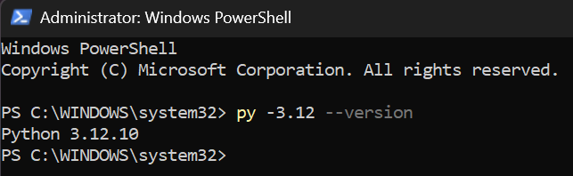
*Screenshot 01, Beginning: Python 3.12.10 confirmed.*

I created a virtual environment so this project's packages stay separate from everything else on the computer.

**Snag 1: Windows refused to open the toolbox.** Running `.\.venv\Scripts\Activate.ps1` failed with "running scripts is disabled on this system." Windows blocks every PowerShell script file by default, and the activation file is a script.

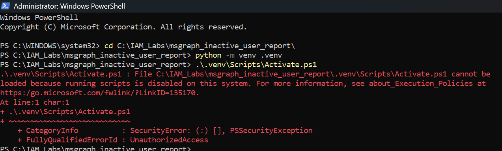
*Screenshot 02, Snag: `PSSecurityException`, `UnauthorizedAccess`.*

**Fix:** `Set-ExecutionPolicy RemoteSigned -Scope CurrentUser`. RemoteSigned lets scripts created on this computer run, while anything downloaded still needs a trusted signature. CurrentUser limits the change to my account instead of the whole machine. I loosened the policy just enough to do the job and no further.

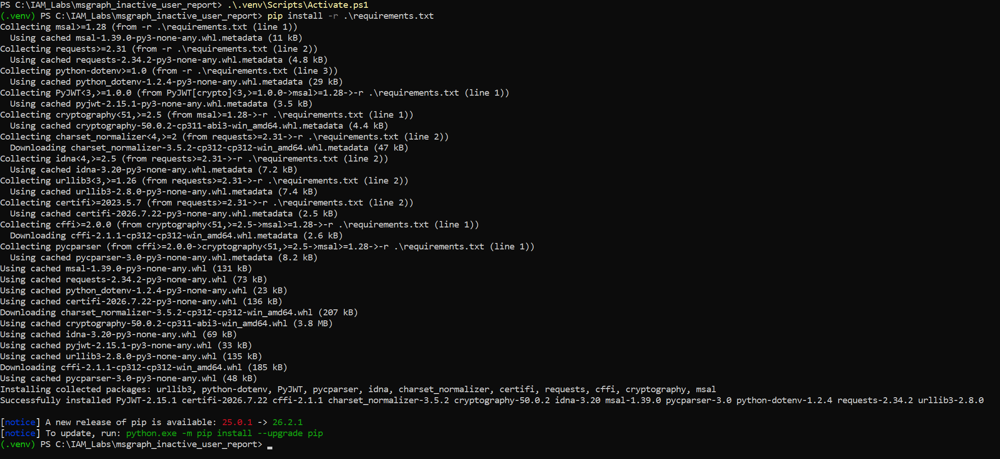
*Screenshot 03, after the fix: `(.venv)` in the prompt, then `pip install -r requirements.txt` installs MSAL, requests, and python dotenv along with what they depend on.*

### Engineer notes

- **One project, one environment.** A `requirements.txt` file means anyone can rebuild the exact same toolbox with one command.
- **Do not reach for Unrestricted.** The narrowest setting that works is the right one.

---

## Part 2: Proving the data exists before writing code

### Situation

Before automating a query, I wanted to run it by hand and see the real answer. Graph Explorer is Microsoft's web tool for sending a single request to Graph and reading the reply.

### Build and snags

I signed in as labadmin and sent:

```
GET https://graph.microsoft.com/v1.0/users?$select=displayName,userPrincipalName,signInActivity
```

**Snag 2: 403 Forbidden.** Graph answered `Authorization_RequestDenied`, "Insufficient privileges to complete the operation." Graph Explorer starts with permission to read only my own profile. I had asked for every user and their sign in history.

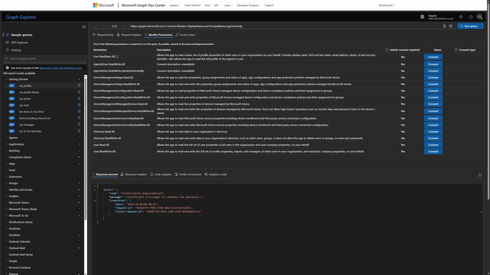
*Screenshot 04, Snag: the 403, with the Modify permissions tab listing what the query could use.*

**Fix:** consented to exactly two permissions: `User.Read.All` to read every user, and `AuditLog.Read.All` to unlock sign in dates. Every ReadWrite option on that list stayed unconsented.

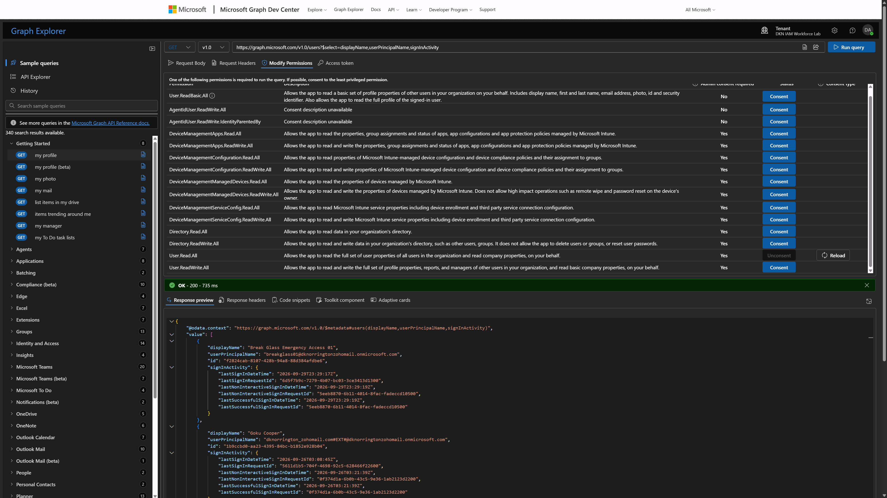
*Screenshot 05, Middle: `User.Read.All` consented. `User.ReadWrite.All` and `Directory.ReadWrite.All` were offered and left alone.*

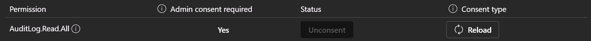
*Screenshot 06, Middle: `AuditLog.Read.All` consented.*

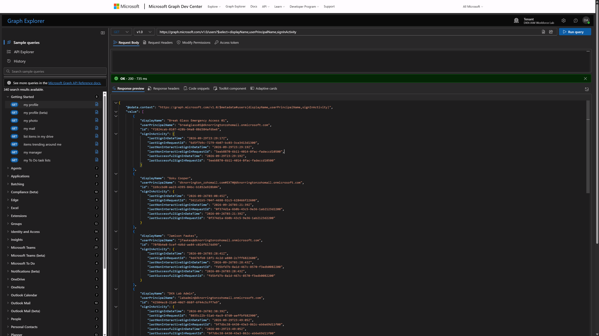
*Screenshot 07, End: `200 OK` in 735 ms with real `signInActivity` data for every user.*

The raw data taught me two things before I wrote a single line of Python:

1. **One date is not enough.** DKN Lab Admin's last *interactive* sign in was September 26, but its last *non interactive* sign in was September 29. A report that only read the first field would think labadmin went quiet three days before it really did. The script reads both and keeps whichever is newer.
2. **Goku Cooper's username contains `#EXT#`.** That marks an account invited from outside the company. I made a note of it. It came back later.

### Real world mapping

Running the query by hand first is the API version of testing Tomcat alone before deploying SailPoint on it. If the script fails later, I already know the data and the permissions are fine, so the problem is in my code.

---

## Part 3: Giving the script its own identity

### Situation

Graph Explorer acted as me. A report that runs on a schedule cannot depend on a person being signed in, so the script needed its own identity in Entra ID.

### Build and snags

**Snag 3: the menu had moved.** The path I expected, Identity, Applications, App registrations, no longer exists. Microsoft reorganized the admin center, and App registrations now sits directly under **Entra ID**.

I registered `DKN-IAM-Graph-Inactive-Report` as **single tenant** with no redirect URI. Single tenant means only accounts in my own lab can use it. A redirect URI is only needed when a person signs in through a browser.

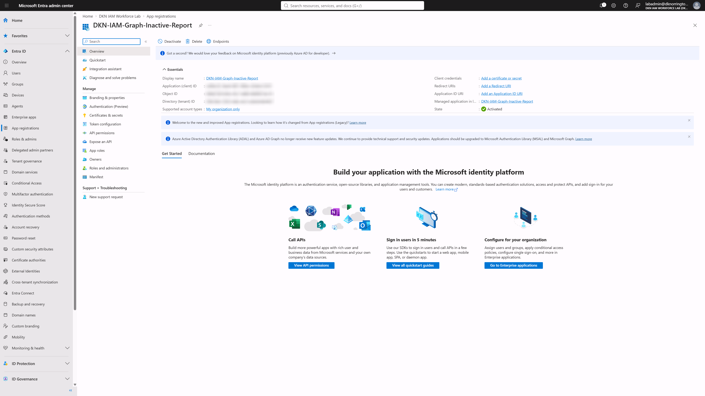
*Screenshot 08, Beginning: the app exists, "My organization only." Client, object, and tenant IDs blurred.*

Then I added the same two permissions as in Graph Explorer, but as **Application** permissions this time, not Delegated. Same names, different meaning: Delegated means "act as the signed in person." Application means "act as yourself, with nobody signed in."

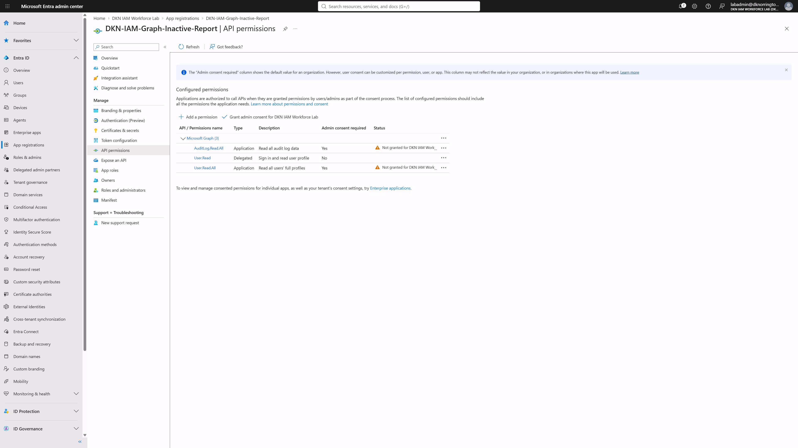
*Screenshot 09, Middle: `AuditLog.Read.All` and `User.Read.All` as Application permissions, both showing "Not granted."*

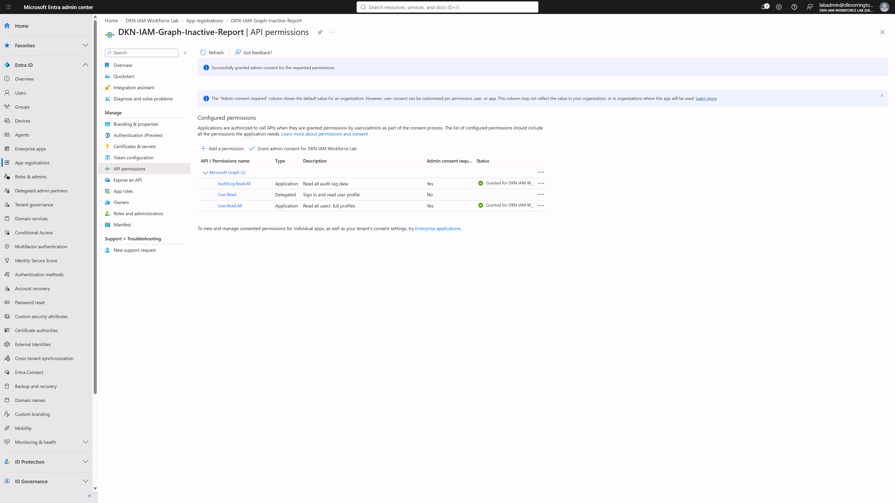
*Screenshot 10, Middle: after admin consent, both show green "Granted for DKN IAM Workforce Lab." The default Delegated `User.Read` is still listed. The script never uses it, and removing it is on my production list below.*

Next came the client secret, the app's password. Its value is shown once, so I copied it straight into my local `.env` file.

**Snag 4: a secret showed up in a screenshot.** The first screenshot of the secrets page showed most of the secret value in plain text before I blurred it. In a lab the risk is small, but the professional rule is simple: a secret that has been exposed is a secret that has been burned. I revoked it, created a new one, and put only the new value in `.env`.

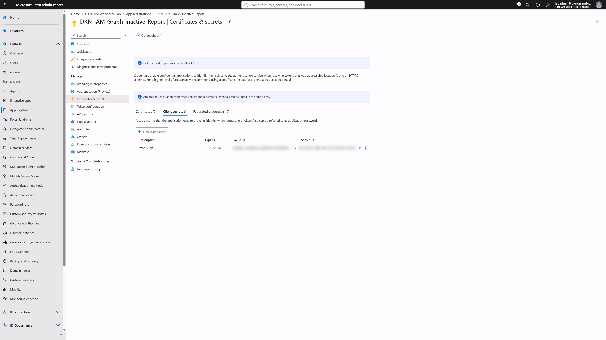
*Screenshot 11, End: the client secret with both the value and the secret ID blurred. Expires 12/31/2026, about 90 days out.*

Full configuration and the reasoning behind each setting are in [`evidence/03_app_registration_configuration.md`](evidence/03_app_registration_configuration.md).

### Engineer notes

- **Least privilege for apps, not just people.** Two read permissions. The script can see everything it needs and change nothing.
- **Short secret lifetime.** 90 days limits the damage if a secret leaks and forces a rotation habit.
- **A certificate is better than a secret** for production. It cannot be copied out of a screenshot. That is on the list below.

---

## Part 4: Setting up test data that can prove something

### Situation

The report looks up each flagged person's manager. If every user had a manager, I would never see how the script handles one who does not.

### Build and snags

I gave Jamison Fawkes, Lena Oxton, and Maugaloa Malosi a manager, Lúcio Correia dos Santos, and left Vaira Singhania without one on purpose as a control.

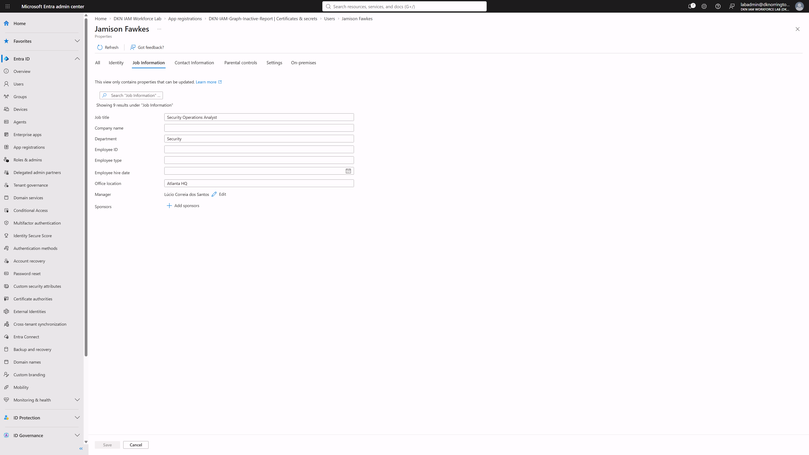
*Screenshot 12, Middle: Jamison Fawkes, Security Operations Analyst, manager Lúcio Correia dos Santos.*

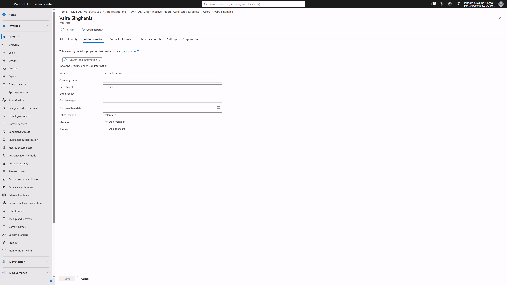
*Screenshot 13, Middle: Vaira Singhania, Financial Analyst, "Add manager" still showing. This is the control case.*

**Snag 5: one change never saved.** Reviewing my own screenshots, the Save button on Maugaloa's page was still blue while the others were gray. Blue meant the manager change was still pending. I went back, saved it, and the final report confirms her manager came through. Unsaved changes look exactly like saved ones until you check.

### Real world mapping

An inactive account with no manager has nobody to approve disabling it. That is how stale accounts survive for years, and why the report calls it out instead of leaving the column blank.

---

## Part 5: How the script works

### Situation

With the data proven and the identity built, the script's job is to do in seconds what Part 2 did by hand, for every user, and turn the answer into decisions.

### Build

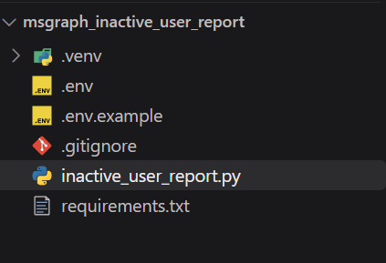
*Screenshot 14, Middle: the project in VS Code. `.env` holds the real secrets locally. `.env.example` shows the setting names with fake values. `.gitignore` keeps `.env`, `.venv`, and the reports off GitHub.*

The script has five jobs.

**1. Settings and sign in.** `load_settings` reads `.env` and stops with a plain English message if anything is missing, including a hint about the classic Windows trap of a file secretly named `.env.txt`. `get_token` hands the client ID and secret to Microsoft through MSAL and gets an access token back. This is the client credentials flow from Week 2, running for real.

**2. Talking to Graph.** `graph_get` attaches the token to every request. If Graph answers 429, meaning slow down, the script waits the number of seconds Graph asks for and tries again. `get_all_users` asks for 120 users at a time, which is the maximum Graph allows when `signInActivity` is included, and follows `@odata.nextLink` until there are no pages left. If Graph returns an error, `stop_on_error` prints the error code, the message, and a hint for the two most common ones (401 and 403).

**3. Deciding who is inactive.** `last_activity` compares the interactive and non interactive sign in dates and keeps the newer one, which is the labadmin lesson from Part 2. `classify` then puts each account into one of four piles:

| Pile | Rule | Flagged? |
| --- | --- | --- |
| Active | Activity after the cutoff | No |
| Inactive N+ days | Last activity on or before the cutoff | Yes |
| Never signed in | No activity at all, and created on or before the cutoff | Yes |
| Too new to judge | No activity, but created after the cutoff | No. A new hire who started yesterday is not a finding |

**4. Recommended action.** Not every stale account gets the same fix:

| Account | Recommended action |
| --- | --- |
| Listed in `EXCLUDE_UPNS` (break glass) | Verify it is monitored. Do not disable |
| Already disabled | Remove licenses and group access, then delete |
| External (see Part 8) | Confirm with the inviting sponsor, then remove access |
| Everyone else | Confirm with manager, then disable |

**5. The report.** Each flagged account gets a manager lookup and a row in `reports/inactive_users_<days>d_<timestamp>.csv`, sorted with the stalest accounts first. Dates are in UTC. The file is saved as UTF 8 with a byte order mark so Excel shows names like Lúcio correctly. The console prints a summary with users scanned, findings by type, accounts with no manager, and run time.

### Engineer notes

- **Read only on purpose.** The report recommends. A human approves. A separate, approved step disables. A report that disables accounts on its own is a fast way to lock out the CFO.
- **Settings outside the code.** The threshold, exclusions, and credentials all live in `.env`, so the same script runs at 90 days in production and 3 days in a demo without editing a line.

---

## Part 6: The first runs

### Build and snags

**Snag 6: `ModuleNotFoundError: No module named 'msal'`.** The packages were installed, and the prompt said `(.venv)`, so this one was confusing.

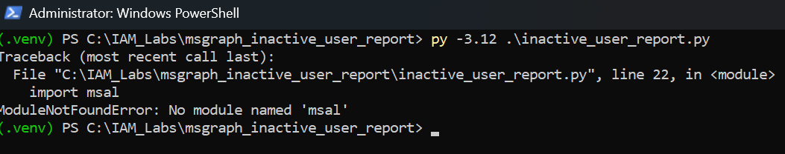
*Screenshot 15, Snag: `py -3.12 .\inactive_user_report.py` fails on line 22, `import msal`.*

**Root cause:** there were two Pythons on the computer. The packages lived in the project's virtual environment. The `py -3.12` launcher skips the virtual environment and goes straight to the main Python install, which has never heard of MSAL. The `(.venv)` in the prompt only changes what the plain `python` command points to.

**Fix:** run it with `python`, which inside an active virtual environment points to `.venv\Scripts\python.exe`.

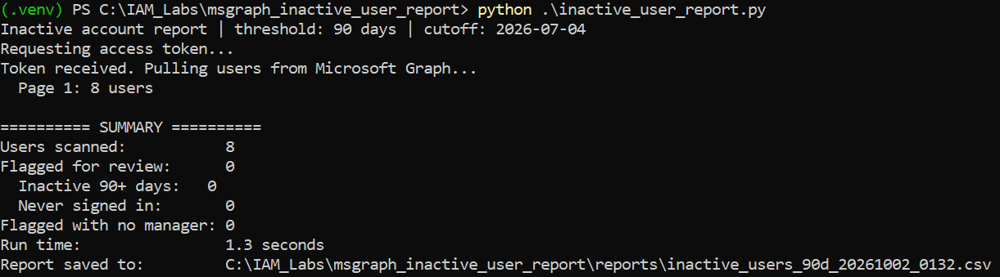
*Screenshot 16, after the fix: token received, 8 users in 1 page, 0 flagged, 1.3 seconds.*

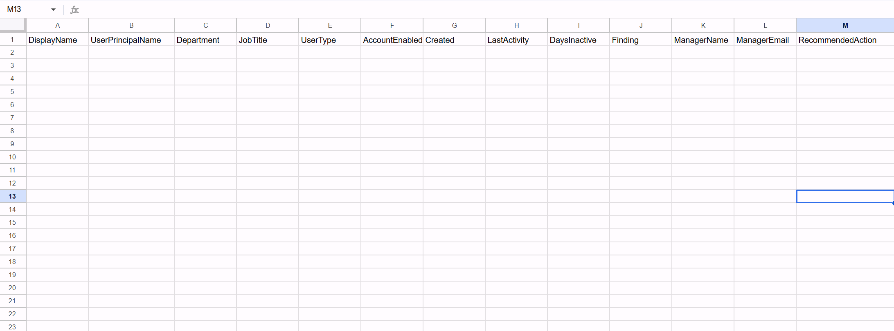
*Screenshot 17, End: the 90 day report. Headers only.*

**Snag 7: zero findings, twice.** I ran it again at 7 days and still got zero. An empty report is either a clean tenant or a broken script, and the CSV alone cannot tell you which. The console can.

**How I checked:** "Users scanned: 8" matches the 8 accounts in the tenant, so the script saw everyone. Then I compared against the dates from Graph Explorer. Today was October 2, so a 7 day cutoff was September 25, and every account had activity after that. The three users who had never signed in were created September 26, after the cutoff, so the too new to judge rule correctly protected them. The script was right. The tenant is just too young and too active to have stale accounts.

### Engineer notes

- **Zero is a result.** "No findings at the production threshold" is real audit evidence, as long as you can prove the script actually looked.
- **The count of what was scanned matters as much as what was found.**

---

## Part 7: Predicting the answer, then proving it

### Situation

To prove the logic works, I needed a threshold that would actually catch someone. Instead of just lowering it and hoping, I predicted the result first.

### Build

Moving the threshold to 3 days puts the cutoff at September 29. From the Graph Explorer data in Part 2, Goku Cooper and Jamison Fawkes (last activity September 26) should be flagged. Break Glass and labadmin (activity on September 29) should not.

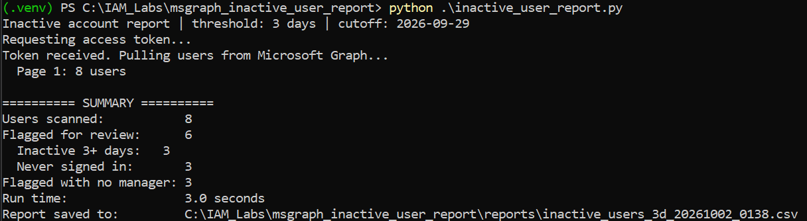
*Screenshot 18, Middle: 8 scanned, 6 flagged (3 inactive, 3 never signed in), 3 with no manager, 3.0 seconds. The extra time over the 90 day run is the 6 manager lookups.*

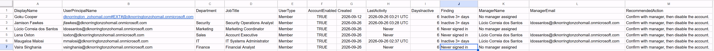
*Screenshot 19, Middle: the six findings with managers resolved.*

| Prediction | Result |
| --- | --- |
| Goku Cooper and Jamison Fawkes flagged | ✅ Both flagged, 6 days inactive |
| Break Glass and labadmin not flagged | ✅ Neither appears |
| Never signed in users appear once older than the cutoff | ✅ Lúcio, Lena, and Vaira now flagged, after being protected at 7 days |
| Vaira shows no manager | ✅ "No manager assigned" |

The report also surfaced something I did not plan: **the manager is a ghost.** Lúcio Correia dos Santos manages three of the flagged users but has never signed in himself, and has no manager of his own. In a real company, the person who is supposed to approve disabling three stale accounts is a stale account too. Nobody owns the decision.

The full triage of every account is in [`evidence/02_findings_triage.md`](evidence/02_findings_triage.md), and every run is logged in [`evidence/01_report_run_results.md`](evidence/01_report_run_results.md).

---

## Part 8: The bug the clean run was hiding

### Situation

The 3 day report matched every prediction. I could have stopped there. Instead I read every row and asked whether each recommended action made sense for that specific account.

### Build and snags

**Snag 8: an outsider labeled as an employee.** Goku Cooper's username has `#EXT#`, so it is an external account. But the `UserType` column said **Member**, and the script recommended "Confirm with manager, then disable." Goku has no manager. External accounts belong to whoever invited them.

**Root cause:** my code decided whether an account was external by checking `userType == "Guest"`. But Entra lets you invite an outside person as a **Member**, which gives them more access than a normal guest. My logic only covered the more common case.

**Fix:** an account now counts as external if it is a Guest **or** its username contains `#EXT#`. External members are labeled `Member (external)` and get "Confirm with the inviting sponsor, then remove access."

```python
def is_external(user):
    upn = user.get("userPrincipalName") or ""
    return user.get("userType") == "Guest" or "#EXT#" in upn.upper()
```

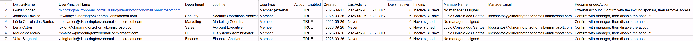
*Screenshot 20, after the fix: Goku Cooper is now `Member (external)` with the sponsor action. Every other row is identical to Screenshot 19, so the fix changed exactly one thing.*

Then I checked the account in the portal instead of trusting my own output.

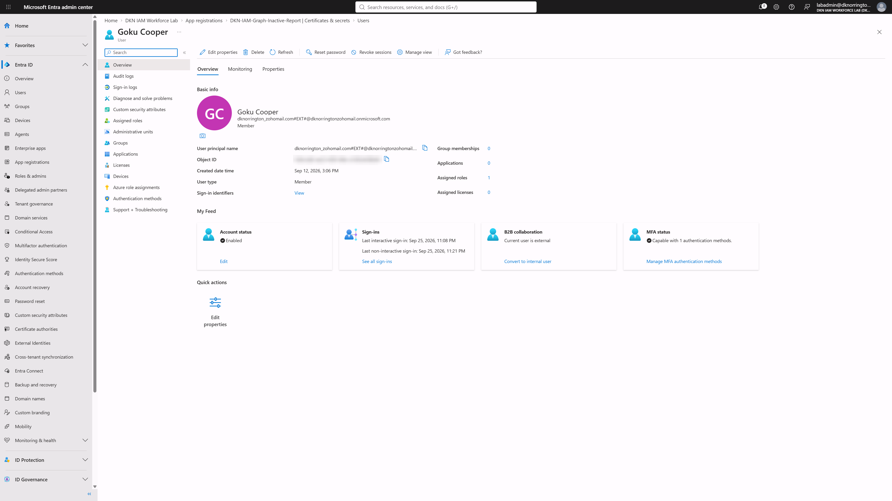
*Screenshot 21, End: User type Member, B2B collaboration "Current user is external," and **Assigned roles: 1**. Object ID blurred.*

**Snag 9: the dates looked a day off.** The portal shows Goku's last non interactive sign in as **Sep 25, 11:21 PM**. My report says **2026-09-26 03:21 UTC**. Same minute, different day.

**Root cause:** not a bug. The portal shows my local time (Eastern, four hours behind UTC), and the report uses UTC. 11:21 PM Eastern on September 25 is 3:21 AM UTC on September 26. The portal also shows the interactive sign in at 11:08 PM, which confirms the script picked the newer of the two dates.

That "Assigned roles: 1" turned this from a labeling fix into the most important finding of the week. This account is external, has member level access, has no manager, has been inactive, and holds a directory role. Each of those is a yellow flag. Together they describe exactly the kind of account attackers look for, because nobody inside the company feels responsible for it.

### Engineer notes

- **A clean run is not a correct run.** Every test passed. The bug only showed up when I asked whether each recommendation made sense.
- **Change one thing, then check everything else.** Comparing Screenshots 19 and 20 row by row is a regression check.
- **Reports use UTC on purpose.** A reviewer in Atlanta and one in London should never argue about what day something happened.

### Real world mapping

Stale B2B accounts are one of the most common findings in Entra ID access reviews. Companies invite contractors and partners, the project ends, and nobody remembers to remove them, especially when they were invited as members instead of guests.

---

## Final result

| Deliverable | Status | Evidence |
| --- | --- | --- |
| Workbench | Python 3.12 in a virtual environment, dependencies pinned in `requirements.txt` | Screenshots 01 to 03 |
| Query proven by hand | 403 resolved with two read permissions, then `200 OK` with real sign in data | Screenshots 04 to 07 |
| App identity | Single tenant app registration, 2 read only Application permissions with admin consent, 90 day secret rotated after exposure | Screenshots 08 to 11, evidence 03 |
| Test data | 3 users with a manager, 1 control user without | Screenshots 12 and 13 |
| Script | Client credentials auth, pagination, 429 retry, both sign in dates, new hire grace, manager lookup, recommended actions, UTC CSV | Screenshot 14, `scripts/` |
| Production run | 8 of 8 users scanned, 0 findings at 90 days, 1.3 seconds | Screenshots 16 and 17, evidence 01 |
| Logic proof | 3 day threshold matched every prediction, 6 flagged, 3 with no manager, 3.0 seconds | Screenshots 18 and 19, evidence 01 and 02 |
| Detection fix | External members now identified, regression checked, cross checked in the portal | Screenshots 20 and 21, evidence 04 |

---

## Troubleshooting summary

| # | Snag | Layer | Root cause | Fix |
| --- | --- | --- | --- | --- |
| 1 | `Activate.ps1` blocked | OS policy | Windows blocks PowerShell scripts by default | `RemoteSigned` for the current user only |
| 2 | Graph Explorer 403 | Authorization | Graph Explorer starts with access to your own profile only | Consented to `User.Read.All` and `AuditLog.Read.All`, nothing broader |
| 3 | Identity, Applications menu missing | Platform change | Admin center reorganized | Entra ID, App registrations |
| 4 | Secret visible in a screenshot | Secret handling | Captured before blurring | Revoked and reissued, blurred the screenshot |
| 5 | Manager change pending | Data entry | Save never clicked | Saved, confirmed in the report output |
| 6 | `No module named 'msal'` | Python environment | `py` launcher bypassed the virtual environment | Ran with `python` inside the active venv |
| 7 | Zero findings at 90 and 7 days | Data, working as designed | Young tenant, new hires inside the grace window | Verified 8 of 8 scanned, proved logic at 3 days |
| 8 | External member treated as an employee | Detection logic | Checked `userType == "Guest"` only | Also check for `#EXT#`, reran and compared |
| 9 | Report date one day off from portal | Time zones | Portal in Eastern, report in UTC | Confirmed the same moment, documented UTC |

---

## Verification log

| Area | What could have hidden a problem | How I checked | What the evidence showed |
| --- | --- | --- | --- |
| Data source | Code bugs and permission problems look the same | Ran the query by hand in Graph Explorer first | Data and permissions confirmed before any code ran |
| Sign in dates | One field can be days behind the other | Compared interactive and non interactive for labadmin | 3 day gap, so the script reads both |
| Permissions | An app can hold more than it needs | Reviewed the permission list after consent | 2 read only Application permissions granted |
| Test data | A pending change looks saved | Reviewed my own screenshots | Caught an unsaved manager |
| Completeness | An empty report can mean nothing was scanned | Compared users scanned to the tenant | 8 of 8 |
| Logic | Lowering a threshold proves nothing without a prediction | Predicted flagged accounts from raw Graph data | Every prediction matched |
| Recommendations | A correct finding can carry the wrong action | Read every row and asked if the action fit | Found the external member gap |
| Regression | A fix can change more than intended | Compared before and after CSVs row by row | Only the intended row changed |
| Source of truth | A script can disagree with the portal | Cross checked Goku in Entra | Same moment, different time zones |

---

## What I would change before calling this production ready

- **Use a certificate instead of a client secret,** stored in a key vault, so there is no password that can leak in a screenshot or a file.
- **Remove the default Delegated `User.Read` permission** from the app registration. The script never uses it.
- **Run it on a schedule** with Task Scheduler or Azure Automation, the same way the Week 8 report runs every Monday.
- **Flag inactive accounts that hold directory roles or PIM eligibility,** which needs `RoleManagement.Read.Directory`. Goku Cooper's role and Maugaloa's Week 7 PIM eligibility would have been in the report automatically.
- **Read the inviting sponsor for external accounts** so the report names who to contact instead of just saying "the sponsor."
- **Use `$expand=manager` in the user query** so a large tenant does not need one extra call per flagged user.
- **Send the report to a real channel,** like a Teams webhook or a ticket queue, instead of a local folder.
- **Feed findings into access reviews** so remediation is tracked and approved inside the governance process (Week 11).

---

## Interview talking points (Problem, Solution, Impact, Learning)

**"Tell me about a bug you found that your tests did not catch."**

- **Problem:** My inactive account report passed every test, but one external account was getting the wrong recommended action.
- **Solution:** I read every row instead of trusting the summary, saw `#EXT#` in a username labeled Member, and traced it to logic that only checked for Guests. I added a check for the `#EXT#` marker and reran.
- **Impact:** Only that one row changed, and the account turned out to be the riskiest on the list: external, no manager, inactive, and holding a directory role.
- **Learning:** A clean run is not a correct run. Review output against what it is supposed to mean, not just whether it ran.

**"What is the difference between delegated and application permissions?"** Delegated means the app acts as a signed in user and can never do more than that user can. Application means the app acts as itself with nobody signed in, and it gets exactly what was granted, across the whole tenant. I used Delegated in Graph Explorer to test the query as myself, and Application for the script so it can run unattended. Same permission names, different blast radius, which is why Application permissions need admin consent.

**"How do you know your script did not miss anyone?"** Three ways: it follows `@odata.nextLink` until there are no more pages, it prints how many users it scanned so I can compare to the tenant, and I predicted which accounts a test threshold should catch before running it.

**"Why check two sign in dates?"** Interactive is a person typing a password. Non interactive is an app like Outlook renewing a token in the background. In my tenant, an admin's interactive date was three days older than its non interactive one. Checking only one would flag people who are actively using their account.

**"Your report says no findings. Is that good?"** Only if you can prove it looked. Mine showed 8 of 8 users scanned at 90 days, and a 3 day test run flagged exactly the accounts I predicted, so zero meant clean, not broken.

---

## Resume bullet

> Built a Python integration with the Microsoft Graph REST API that authenticates as a least privilege Entra ID app registration (OAuth 2.0 client credentials through MSAL, 2 read only application permissions), retrieves every user's interactive and non interactive sign in activity with pagination and throttling handling, and produces a remediation CSV with manager lookup and a recommended action for each account.
>
> Validated the report against all 8 identities in an Entra ID P2 tenant in about 3 seconds, confirmed predicted results at a test threshold (6 flagged, 3 with no manager), and found and fixed a detection gap where an external B2B member holding a directory role was classified as an employee.

*Only add a time saved or percentage figure if you have a measured manual baseline to compare against.*

---

## Run it yourself

Requirements: Python 3.11 or newer, a Microsoft Entra ID tenant with P1 or P2, and an app registration with `User.Read.All` and `AuditLog.Read.All` as Application permissions with admin consent.

```powershell
# From the repo root
python -m venv .venv
.\.venv\Scripts\Activate.ps1          # if blocked: Set-ExecutionPolicy RemoteSigned -Scope CurrentUser
pip install -r requirements.txt

# Copy .env.example to .env and fill in TENANT_ID, CLIENT_ID, CLIENT_SECRET,
# INACTIVE_DAYS (90 is the policy), and EXCLUDE_UPNS (your break glass UPN)
Copy-Item .env.example .env
notepad .env

# Use python, not py, so the virtual environment is used
python scripts/inactive_user_report.py
```

Reports land in `reports/`, which is git ignored because it contains account data.

---

## Repository layout

```
msgraph_inactive_user_report/
├── README.md
├── .gitignore
├── .env.example
├── requirements.txt
├── evidence/
│   ├── 01_report_run_results.md
│   ├── 02_findings_triage.md
│   ├── 03_app_registration_configuration.md
│   └── 04_inactive_users_3_day_after_fix.csv
├── scripts/
│   └── inactive_user_report.py
└── screenshots/
    ├── 01_python_version_check.png
    ├── 02_venv_activation_blocked_execution_policy.png
    ├── 03_venv_active_pip_install_requirements.png
    ├── 04_graph_explorer_403_insufficient_privileges.png
    ├── 05_graph_explorer_user_read_all_consented.png
    ├── 06_graph_explorer_auditlog_read_all_consented.png
    ├── 07_graph_explorer_users_signin_activity_success.png
    ├── 08_app_registration_overview.png
    ├── 09_api_permissions_application_type.png
    ├── 10_admin_consent_granted.png
    ├── 11_client_secret_created_value_hidden.png
    ├── 12_manager_assigned_in_entra.png
    ├── 13_no_manager_control_user.png
    ├── 14_vscode_project_structure.png
    ├── 15_first_run_error_module_not_found.png
    ├── 16_successful_run_90_day_summary.png
    ├── 17_csv_90_day_no_findings.png
    ├── 18_demo_run_3_day_summary.png
    ├── 19_csv_3_day_findings_before_fix.png
    ├── 20_csv_3_day_external_member_fixed.png
    └── 21_portal_goku_cooper_external_member.png
```

*Built as part of the IAM Engineer Mentorship Program, Week 9. This is a lab environment with test data only. Client ID, tenant ID, object IDs, and the client secret are blurred or excluded.*
